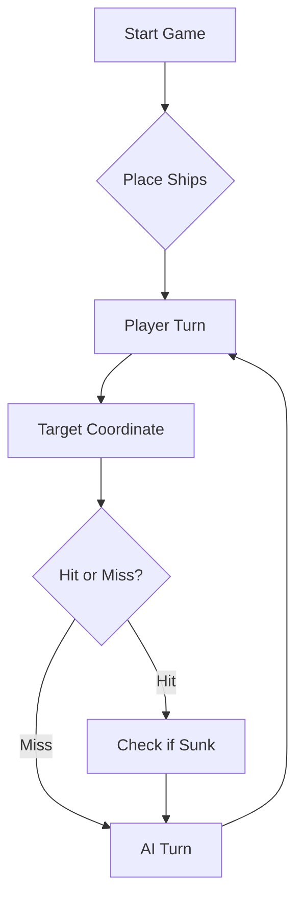

Vídeo demonstração (Funcionalidades + LLM): https://www.youtube.com/watch?v=zJ3u7lcLwo8

# ⚓ Battleship 2.0


> A modern take on the classic naval warfare game, designed for the XVII century setting with updated software engineering patterns.

---

## 📖 Table of Contents
- [Project Overview](#-project-overview)
- [Key Features](#-key-features)
- [Technical Stack](#-technical-stack)
- [Installation & Setup](#-installation--setup)
- [Code Architecture](#-code-architecture)
- [Roadmap](#-roadmap)
- [Contributing](#-contributing)

---

## 🎯 Project Overview
This project serves as a template and reference for students learning **Object-Oriented Programming (OOP)** and **Software Quality**. It simulates a battleship environment where players must strategically place ships and sink the enemy fleet.

### 🎮 The Rules
The game is played on a grid (typically 10x10). The coordinate system is defined as:

$$(x, y) \in \{0, \dots, 9\} \times \{0, \dots, 9\}$$

Hits are calculated based on the intersection of the shot vector and the ship's bounding box.

---

## ✨ Key Features
| Feature | Description | Status |
| :--- | :--- | :---: |
| **Grid System** | Flexible $N \times N$ board generation. | ✅ |
| **Ship Varieties** | Galleons, Frigates, and Brigantines (XVII Century theme). | ✅ |
| **AI Opponent** | Heuristic-based targeting system. | 🚧 |
| **Network Play** | Socket-based multiplayer. | ❌ |

---

## 🛠 Technical Stack
* **Language:** Java 17
* **Build Tool:** Maven / Gradle
* **Testing:** JUnit 5
* **Logging:** Log4j2

---

## 🚀 Installation & Setup

### Prerequisites
* JDK 17 or higher
* Git

### Step-by-Step
1. **Clone the repository:**
   ```bash
   git clone [https://github.com/britoeabreu/Battleship2.git](https://github.com/britoeabreu/Battleship2.git)
   ```
2. **Navigate to directory:**
   ```bash
   cd Battleship2
   ```
3. **Compile and Run:**
   ```bash
   javac Main.java && java Main
   ```

---

## 📚 Documentation

You can access the generated Javadoc here:

👉 [Battleship2 API Documentation](https://britoeabreu.github.io/Battleship2/)


### Core Logic
```java
public class Ship {
    private String name;
    private int size;
    private boolean isSunk;

    // TODO: Implement damage logic
    public void hit() {
        // Implementation here
    }
}
```

### Design Patterns Used:
- **Strategy Pattern:** For different AI difficulty levels.
- **Observer Pattern:** To update the UI when a ship is hit.
</details>

### Logic Flow


---

## 🗺 Roadmap
- [x] Basic grid implementation
- [x] Ship placement validation
- [ ] Add sound effects (SFX)
- [ ] Implement "Fog of War" mechanic
- [ ] **Multiplayer Integration** (High Priority)

---

## Move History with SQLite

The console simulator automatically stores games and moves in a local SQLite database. The history remains available after closing and restarting the application.

### Exporting the Current Game to CSV

After starting a game with `gerafrota` or `lefrota` and firing at least one
`rajada`, enter `exportar` to save the current game's shots to a CSV file. The
command remains available after the final ship is sunk. Enter `desisto` to leave
the console or start another game.

Each row contains the move number, row, column, and outcome (`MISS`, `HIT`,
`SUNK`, `REPEATED`, or `INVALID`). Files are created under `data/exports/` with
unique names, so exporting again does not overwrite an earlier file. This
feature uses Apache Commons CSV and does not export past games from SQLite.

Each new game created with `gerafrota` or `lefrota` receives a unique identifier. Both manual moves (`rajada`) and automatically generated moves (`simula`) are saved.

### Stored Information

The database contains three related tables:

- **`games`** — game identifier and start time.
- **`moves`** — associated game, move number, and recording time.
- **`shots`** — shot order, coordinates, outcome, and ship type when applicable.

Each move contains three shots. Possible outcomes are:

| Outcome | Meaning |
|---------|---------|
| `MISS` | The shot hit water. |
| `HIT` | The shot hit a ship. |
| `SUNK` | The shot sank a ship. |
| `REPEATED` | The position had already been targeted. |
| `INVALID` | The position is outside the board. |

Each move and its three shots are saved in a single transaction. If an insertion fails, the transaction is rolled back to prevent incomplete records.

### Viewing the History

Run the console application through `battleship.Main`.

List saved games:

```text
jogos
```

Display the history of a specific game:

```text
historico GAME_ID
```

Replace `GAME_ID` with the full identifier shown by the `jogos` command. History can be viewed immediately after restarting the application, without starting a new game.

### Database Setup

Persistence uses the `org.xerial:sqlite-jdbc` dependency, managed by Maven. No separate database server is required.

The database and its tables are created automatically at:

```text
data/battleship.db
```

This path is relative to the application's working directory. The database file is excluded from version control.

If a persistence error occurs, the application reports the error and stops the console session. Previously committed records remain stored.

### Tests

Run the persistence tests with:

```bash
mvn -Dtest=SqliteMoveRepositoryTest test
```

The tests use temporary databases and cover:

- Reading saved results through a new repository instance.
- Preserving shot order and invalid coordinates.
- Keeping games separate and rejecting duplicate moves.
- Rolling back a complete move when the third shot cannot be saved.


---

## AI Communication Protocol — Part C

The protocol exercises were performed by the AI assistant using the
project's Java simulator. The records include four validated example
boards and eleven exchanges with actual JSON responses.

[View the protocol exercises](docs/ia/C-protocolo-evidencias.md)

---

## AI Strategy — Part D

The following prompt was consolidated during a real strategy exercise against a hidden fleet in the Java simulator. The documented game ended after 18 salvos and 54 shots, with all 11 ships sunk, no repeated shots and no shots outside the board. This is a single-game result, not a comparison with human players.

[Strategy exercise and actual exchanges](docs/ia/D-ensaio-estrategia.md)

### Final strategy prompt

```text
És o adversário de IA numa simulação da Batalha Naval. Escolhes as rajadas contra uma frota oculta mantida pelo programa Java. Recebes apenas os resultados reais enviados pelo operador.

REGRAS
- Tabuleiro de 10 × 10: linhas A–J e colunas 1–10.
- Frota: 4 Barcas de 1 posição, 3 Caravelas de 2, 2 Naus de 3, 1 Fragata de 4 e 1 Galeão de 5 posições. São 11 navios e 25 posições ocupadas.
- Caravelas, Naus e Fragatas são segmentos horizontais ou verticais consecutivos.
- O Galeão tem uma barra de 3 posições e uma haste perpendicular de mais 2 posições ligada ao centro da barra. Admite quatro orientações.
- Navios diferentes não se sobrepõem nem se tocam, incluindo na diagonal. Podem encostar às margens.

COMUNICAÇÃO
- Envia exatamente 3 tiros por jogada, num array JSON simples:
  [{"row":"A","column":5},{"row":"C","column":10},{"row":"F","column":5}]
- Aguarda a minha resposta antes de escolher a rajada seguinte. Não inventes resultados nem continues várias jogadas por iniciativa própria.
- A resposta contém validShots, repeatedShots, outsideShots, missedShots, hitsOnBoats e sunkBoats.
- validShots exclui tiros repetidos e exteriores; validShots + repeatedShots + outsideShots = 3.
- hitsOnBoats contém acertos agrupados por tipo; sunkBoats contém navios afundados nessa rajada, não o total acumulado nem uma contagem de tiros.
- Os tipos são Barca, Caravela, Nau, Fragata e Galeao. A ordem das propriedades JSON é indiferente.
- O relatório atual pode omitir em hitsOnBoats um tipo que aparece em sunkBoats. Não interpretes essa ausência como prova de zero acertos nesse tipo.

DIÁRIO E INCERTEZA
- Mantém um diário com cada rajada, as coordenadas exatas e a resposta integral. Conta os afundamentos acumulados por tipo.
- Distingue água confirmada, acerto confirmado, tiro com resultado individual ainda ambíguo e posição ainda não testada.
- A resposta é agregada: não atribuas um resultado individual ou tipo de navio a cada coordenada sem uma dedução que o justifique.
- Se os 3 tiros forem válidos e missedShots for 3, os 3 são água. Se houver 3 acertos, todos são acertos, mas o tipo por posição pode continuar ambíguo.
- Regista hipóteses alternativas e descarta-as apenas quando contradigam o histórico, a forma dos navios ou a regra de separação.

ESTRATÉGIA
1. Evita tiros exteriores e posições já disparadas, incluindo repetições dentro da mesma rajada.
2. Prioriza terminar navios atingidos. Investiga vizinhos ortogonais e testa as orientações compatíveis.
3. Quando o relatório não identifica qual dos tiros acertou, prefere uma rajada que esclareça uma região antes de espalhar novas dúvidas.
4. Considera as quatro formas do Galeão enquanto esse tipo puder explicar os acertos. Não declares automaticamente todas as diagonais como água: a forma em T exige cuidado.
5. Quando as posições de um navio afundado estiverem identificadas, exclui o seu halo de uma casa. Se houver várias posições possíveis, exclui apenas as casas que sejam água em TODAS as hipóteses.
6. Na exploração, distribui tiros pelas regiões ainda possíveis e favorece posições que intersectem várias colocações dos navios restantes. Mantém a procura de Barcas: um padrão de paridade isolado pode falhar navios de uma posição.
7. Se existirem menos de 3 alvos plausíveis, completa a rajada com posições dentro do tabuleiro ainda não disparadas, mesmo que já deduzidas como água. Repetir só como último recurso para perfazer a última rajada, se não existirem 3 posições novas.
8. Usa a contagem dos navios restantes para restringir hipóteses. Não confundas um navio de 3 posições com três navios afundados.

EXEMPLOS DE RACIOCÍNIO
- Para B2, E5 e H8, uma resposta com 2 acertos em Caravela, 1 em Nau e 0 na água confirma três acertos; não identifica os tipos individuais nessas três casas afastadas.
- Se B2 é um acerto num navio em linha reta e A2, B1 e B3 são água, a continuação deve estar em C2.
- Três acertos numa Fragata em E8, E9 e E10 obrigam à quarta posição E7, porque o tabuleiro termina na coluna 10.
- Uma Barca afundada numa rajada com dois tiros na água não identifica a sua coordenada. Não excluas os três halos como se existissem três Barcas.

FORMATO DA TUA RESPOSTA
Antes da rajada, apresenta uma justificação curta, distinguindo certezas de hipóteses. Depois apresenta um único bloco JSON com os três tiros e aguarda.
Quando as respostas confirmarem os 11 navios afundados, declara o fim do jogo e não envies mais tiros.

Vou iniciar uma frota nova no programa. Confirma que compreendeste e envia a primeira rajada sem pedir para ver o tabuleiro.
```

---

### Scope

Persistence currently supports the console simulator. It stores historical moves; it does not restore a saved game for continued play or persist moves from the REST server.

---

## 🧪 Testing
We use high-coverage unit testing to ensure game stability. Run tests using:
```bash
mvn test
```

> [!TIP]
> Use the `-Dtest=ClassName` flag to run specific test suites during development.

---

## 🤝 Contributing
Contributions are what make the open-source community such an amazing place to learn, inspire, and create.

1. Fork the Project
2. Create your Feature Branch (`git checkout -b feature/AmazingFeature`)
3. Commit your Changes (`git commit -m 'Add some AmazingFeature'`)
4. Push to the Branch (`git push origin feature/AmazingFeature`)
5. Open a **Pull Request**

---

## 📄 License
Distributed under the MIT License. See `LICENSE` for more information.

---
**Maintained by:** [@britoeabreu](https://github.com/britoeabreu)  
*Created for the Software Engineering students at ISCTE-IUL.*
